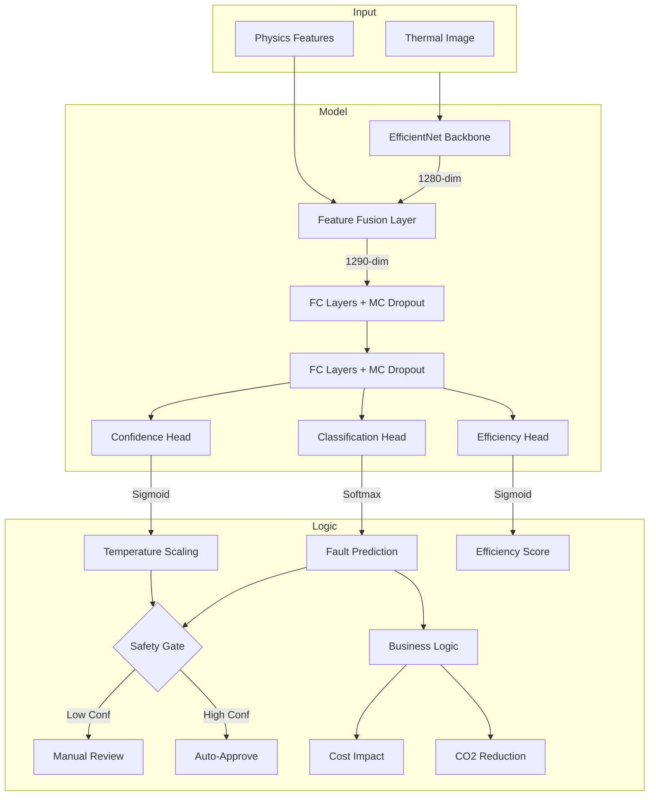
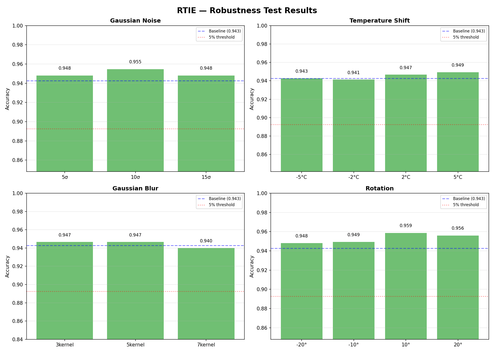
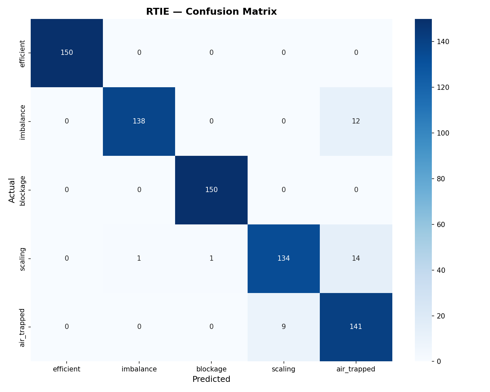
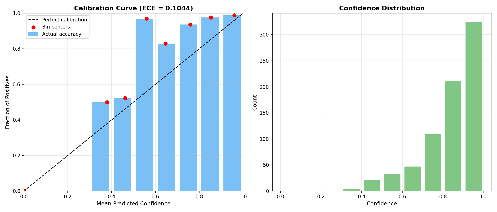
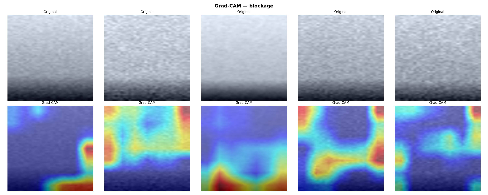

# Radiator Thermal Intelligence Engine (RTIE)


**Physics-informed deep learning prototype for radiator fault detection, trained and tested on simulated thermal images.**

- **95.07%** accuracy on a held-out *synthetic* test set (750 images)
- **0.1044** ECE (Temperature Scaled)
- **>94%** accuracy under simulated noise, blur, rotation and drift
- **10ms** ONNX CPU Inference
- **Explainable** via Grad-CAM

---

## 1. Executive Summary

**Heating inefficiencies in domestic radiators are often difficult to detect through manual thermal inspection, leading to energy waste and inconsistent diagnostics.**

RTIE is a deep learning prototype that diagnoses radiator faults (Blockage, Scaling, Air Trapped, Imbalance) from thermal images. It combines an **EfficientNet-B0** image backbone with hand-built **physics features** (thermal gradients, entropy, cold-spot ratios) to make predictions easier to interpret.

The dataset consists of **5,000 thermodynamically simulated radiator heatmaps** (1,000 per class) with injected stochastic sensor noise and temperature drift to approximate real-world variability.

It includes uncertainty estimation (MC Dropout) and calibration (temperature scaling), so that low-confidence predictions are routed to manual review instead of being auto-approved.

> **Important:** all results below come from simulated data. The model has not been tested on images from a real thermal camera, so real-world accuracy is unknown.

---

## 2. Repository Structure

```
rtie/
├── data/                   # Generated by dataset_generator.py (not committed)
├── models/                 # Trained weights are written here (not committed)
├── report/                 # Plots, metrics and Grad-CAM heatmaps
├── demo/                   # Gradio demo used for the Hugging Face Space
├── docs/                   # Documentation and walkthroughs
├── app.py                  # FastAPI inference API
├── business_metrics.py     # Energy loss and cost impact logic
├── config.py               # Hyperparameters and system constants
├── dataset.py              # PyTorch dataloaders and augmentation
├── dataset_generator.py    # Physics-based synthetic data engine
├── evaluate.py             # Calibration and performance evaluation
├── feature_engineering.py  # Thermal physics feature extraction
├── field_simulation.py     # Deployment scenario stress-tests
├── gradcam.py              # Explainability visualization
├── model.py                # EfficientNet + Fusion architecture
├── robustness_test.py      # Noise and perturbation verification
└── train.py                # Multi-task training pipeline
```

---

## 3. Model Card

**Intended Use:**  
Radiator thermal fault detection in controlled indoor residential environments.

**Not Intended For:**  
Industrial heat exchangers, outdoor radiators, or non-thermal imagery.

**Performance Summary:**  
95.07% test accuracy on synthetic validation set.

**Calibration:**  
ECE reduced to 0.1044 via temperature scaling.

**Risks:**  
Domain shift possible when transitioning to real thermal cameras. Validation on real-world thermal imagery remains necessary prior to operational deployment.

---

## 4. Key Design Decisions

- **EfficientNet-B0 Backbone**: A small backbone chosen to keep CPU inference fast (about 10 ms per image after ONNX export).
- **Physics Feature Fusion**: Adds thermal domain features (e.g., vertical gradients, cold-spot ratios) to the dense layers to make the model's inputs easier to interpret.
- **MC Dropout**: Enables uncertainty estimation by running multiple forward passes at inference time to measure prediction variance.
- **Post-hoc Temperature Scaling**: Applied to calibrate the model's confidence scores, reducing Expected Calibration Error (ECE) from 0.31 to 0.10.
- **ONNX Export**: Lets the model run on CPU without PyTorch and is a starting point for later quantisation.

---

## 5. System Architecture



---

## 6. Performance & Robustness

**Test Set Accuracy**: 95.07% (on 750 held-out images)

### Classification Metrics
| Class | Precision | Recall | F1-Score |
|---|---|---|---|
| **efficient** | 1.0000 | 1.0000 | 1.0000 |
| **imbalance** | 1.0000 | 0.9200 | 0.9583 |
| **blockage** | 0.9868 | 1.0000 | 0.9934 |
| **scaling** | 0.9252 | 0.9067 | 0.9158 |
| **air_trapped** | 0.8528 | 0.9267 | 0.8882 |

### Robustness Profile
The test images were perturbed synthetically to approximate camera noise and handling. These checks do not replace testing on real camera images.

| Perturbation | Accuracy | Status |
|---|---|---|
| **Gaussian Noise (σ = 15)** | **94.8%** | Small drop |
| **Blur (7x7)** | **94.0%** | Small drop |
| **Rotation (±20°)** | **95.6%** | No drop |
| **Thermal Drift (±5°C)** | **>94.0%** | Small drop |



---

## 7. Visual Outputs

### Confusion Matrix


### Calibration Curve


### Grad-CAM Example


---

## 8. Limitations

- **Synthetic Data**: The model was trained entirely on physics-simulated data. While efforts were made to inject realistic noise and variability, a domain gap may exist when deployed on real-world thermal cameras.
- **Air Trapped Precision**: The `air_trapped` class has slightly lower precision (85%) compared to other classes, likely due to feature overlap with `imbalance`.
- **Calibration Target**: While ECE was reduced significantly (0.10), strictly safety-critical applications typically target <0.05 ECE.

---

## 9. Installation & Usage

### Tested On
- Python 3.10+
- PyTorch 2.x
- CUDA 12.x (optional)

### Setup
```bash
git clone https://github.com/Famulkalam/RTIE.git
cd RTIE
pip install -r requirements.txt
```

### Reproducibility
To reproduce the results reported above:
```bash
# 1. Generate Data (Seed fixed in config)
python3 dataset_generator.py

# 2. Train model (up to 30 epochs, early stopping on validation loss with patience 5)
python3 train.py

# 3. Evaluate & Generate Report
python3 evaluate.py
python3 robustness_test.py
```
Random seeds are fixed in `config.py`. Results can still vary slightly across hardware and library versions (GPU kernels are not fully deterministic).

**Model weights are not stored in this repository.** Run the steps above to train them (`models/best_model.pth`), or use the hosted demo below.

### Run API
```bash
uvicorn app:app --port 8000
```
**Example Inference:**
```bash
curl -X POST "http://localhost:8000/predict" \
     -F "file=@data/synthetic/blockage/0001.png"
```

### Quick Demo (Local)
After launching the API, visit:

`http://localhost:8000/docs`

The interactive Swagger UI allows for real-time image upload and inspection directly in your browser.

### Hugging Face Spaces Demo
A Gradio-based demo script is available in the `demo/` folder for visual interaction.

**[Try the Live Demo Here](https://huggingface.co/spaces/famulkalam/RTIE)** 🚀

**Run locally:**
```bash
python3 demo/app.py
```
Then visit `http://localhost:7860`.

**Deploy to Hugging Face Spaces:**
1.  Create a new Space (SDK: **Gradio**).
2.  Connect this repository.
3.  In Settings > **App File**, set to: `demo/app.py`.
4.  The Space will auto-install `demo/requirements.txt` and run the app.

### Sample API Response
```json
{
  "status": "auto_approved",
  "fault_label": "blockage",
  "confidence": 0.8806,
  "uncertainty_std": 0.0446,
  "estimated_annual_cost_gbp": 108.86
}
```

---

## 10. Future Work

- **Real-World Fine-Tuning**: Collect a small dataset of real thermal images to fine-tune the synthetic model (Sim2Real transfer).
- **Active Learning Loop**: Implement a feedback mechanism where "Manual Review" cases are labeled and fed back into training.
- **Edge Quantization**: Further compress the model to INT8 using ONNX Runtime for deployment on microcontrollers.
- **Data Drift Monitoring**: Add drift detection for feature distribution shifts in production.

---

## License
MIT, see [LICENSE](LICENSE).

## Author
Famul Kalam, MSc Business Analytics, University of Edinburgh.
