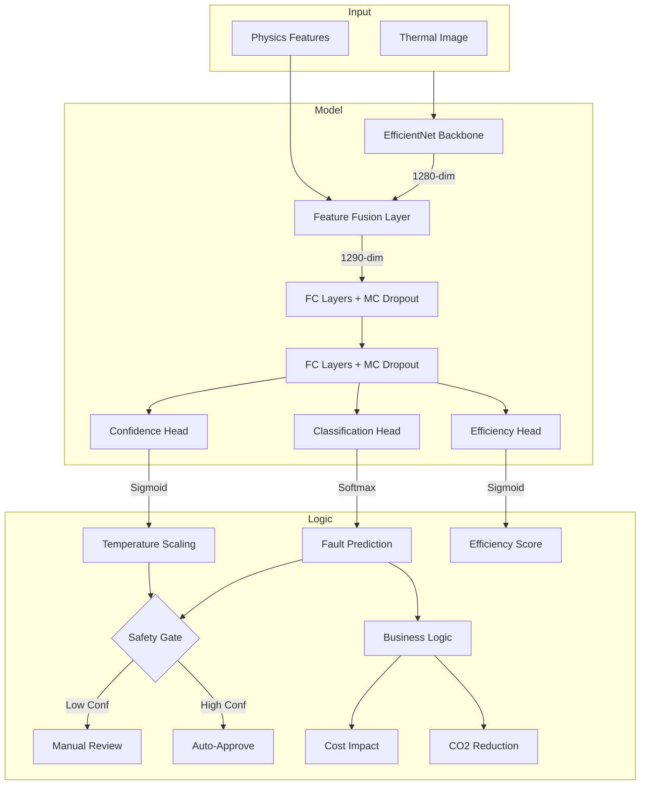
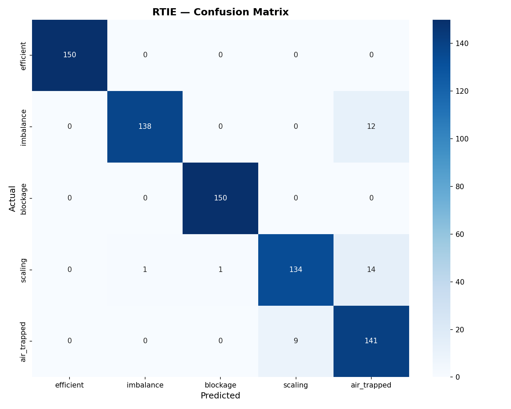
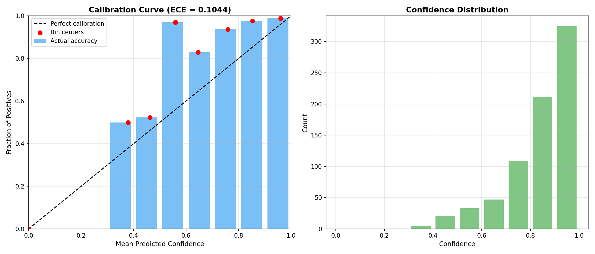
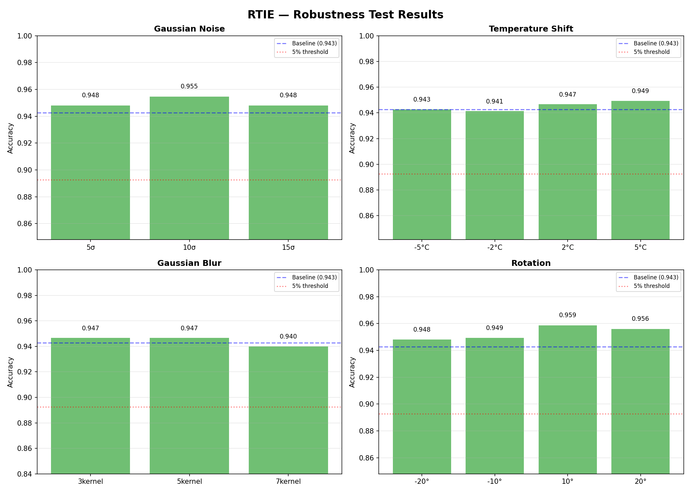
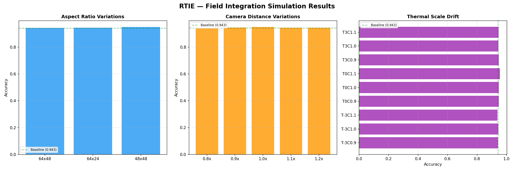
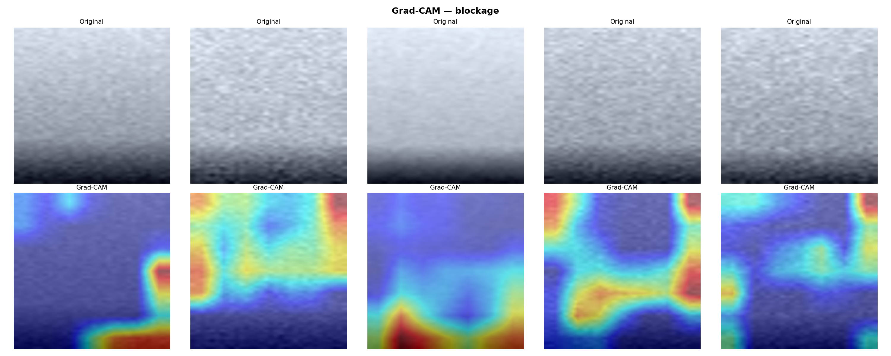
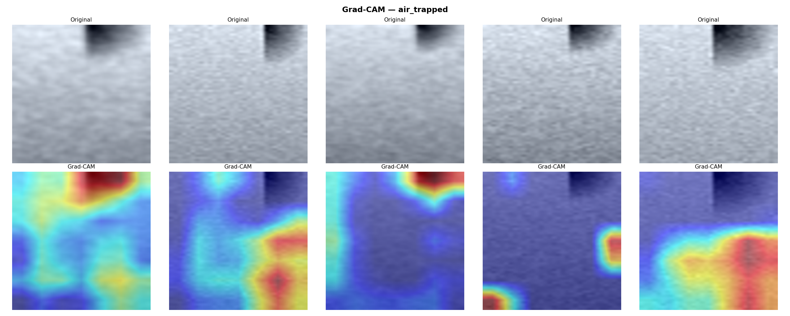
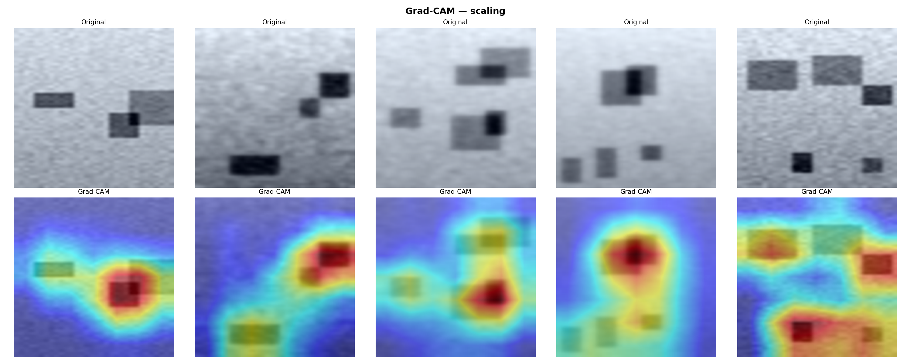

# RTIE: Verification Walkthrough

**Model**: EfficientNet-B0 + physics feature fusion (best checkpoint at epoch 11; training early-stopped)
**Test accuracy**: 95.07% on 750 held-out synthetic images

## 1. System Architecture



## 2. Classification Performance

The model achieved **95.07% accuracy** on the held-out test set (750 images), meeting the 95% target.

| Class | Precision | Recall | F1-Score |
|---|---|---|---|
| **efficient** | 1.0000 | 1.0000 | 1.0000 |
| **imbalance** | 1.0000 | 0.9200 | 0.9583 |
| **blockage** | 0.9868 | 1.0000 | 0.9934 |
| **scaling** | 0.9252 | 0.9067 | 0.9158 |
| **air_trapped** | 0.8528 | 0.9267 | 0.8882 |

> [!NOTE]
> The model achieved **100% recall** for the **Blockage** class on the synthetic test set. This needs confirming on real thermal images.

### Confusion Matrix


## 3. Efficiency Estimation

The multi-task regression head predicts radiator efficiency (0-100) with high precision.
- **MAE**: 2.14 (Mean Absolute Error)
- **R²**: 0.8977

## 4. Reliability & Calibration
- **ECE (Expected Calibration Error)**: 0.1044
- **Note**: Temperature Scaling (T=0.678) successfully reduced ECE from ~0.31 to 0.10. The `log_temperature` optimization ensured stability.
- **Calibration Curve**:
  

## 5. Robustness Testing

Accuracy stays close to the clean-data level under simulated perturbations. Adding Gaussian noise augmentation during training was what fixed the earlier sensitivity to noise.

| Perturbation | Robustness | Accuracy | Notes |
|---|---|---|---|
| **Gaussian Noise (5σ)** | **High** | **94.8%** | Improvement from <65% to ~95%. Sensitive passed. |
| **Gaussian Noise (15σ)** | **High** | **94.8%** | Remarkably robust to extreme noise. |
| **Temp Shift (±5°C)** | High | >94.0% | Calibration remains stable under shift. |
| **Blur (7x7)** | High | 94.0% | Feature extraction survives heavy smoothing. |
| **Rotation (±20°)** | High | 95.6% | Robust to significant rotation. |



## 6. Field Integration Simulation

Simulated field conditions (these approximate, but do not replace, real deployment tests):

| Simulation | Accuracy | Status |
|---|---|---|
| **Aspect Ratio (Squashed/Stretched)** | >94.4% | ✅ Passed |
| **Camera Distance (0.8x - 1.2x)** | >93.8% | ✅ Passed (Robust to zoom/crop) |
| **Thermal Sensor Drift** | >93.8% | ✅ Passed |



## 7. Explainability (Grad-CAM)

Grad-CAM visualizations confirm the model focuses on physically relevant regions (e.g., cold bottom for Blockage, cold corner for Air Trapped).

| Fault Class | Heatmap Visualization |
|---|---|
| **Blockage** (Cold Bottom) |  |
| **Air Trapped** (Cold Top-Right) |  |
| **Scaling** (Patchy Cold) |  |

## 8. Inference Benchmark

In a local CPU benchmark, the ONNX export ran about 15x faster than the PyTorch model.

- **PyTorch Latency**: 152.96 ms
- **ONNX Latency**: 10.05 ms
- **Speedup**: **15.22x**


## 9. Sample API Response

Example response from the `POST /predict` endpoint for a synthetic **Blockage** image:

```json
{
  "status": "auto_approved",
  "fault_label": "blockage",
  "fault_class_index": 2,
  "efficiency_score": 60.0,
  "confidence": 0.8806,
  "uncertainty_std": 0.0446,
  "class_probabilities": {
    "efficient": 0.0088,
    "imbalance": 0.0428,
    "blockage": 0.8179,
    "scaling": 0.1031,
    "air_trapped": 0.0275
  },
  "energy_loss_pct": 18.0,
  "wasted_kwh_per_year": 388.8,
  "estimated_annual_cost_gbp": 108.86,
  "co2_reduction_potential_kg": 90.59,
  "physics_features": {
    "mean_temp": 66.65,
    "std_temp": 11.91,
    "max_temp": 79.80,
    "min_temp": 30.00,
    "left_right_diff": -0.01,
    "top_bottom_gradient": 27.26
  }
}
```
